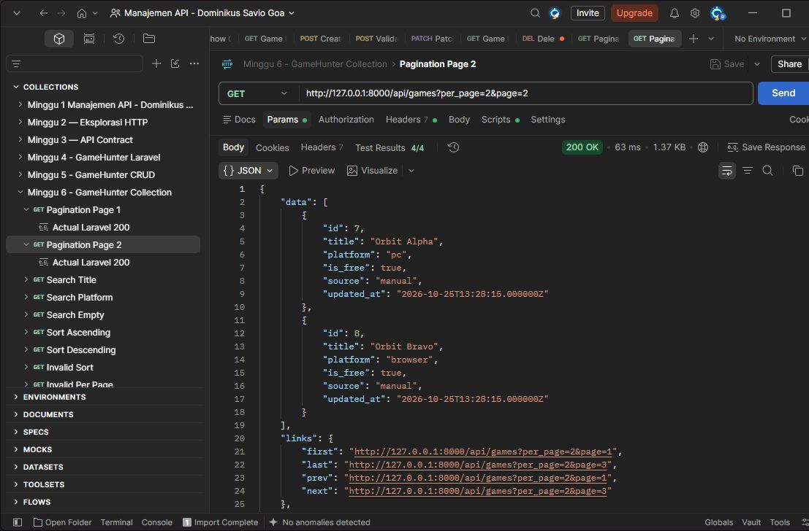
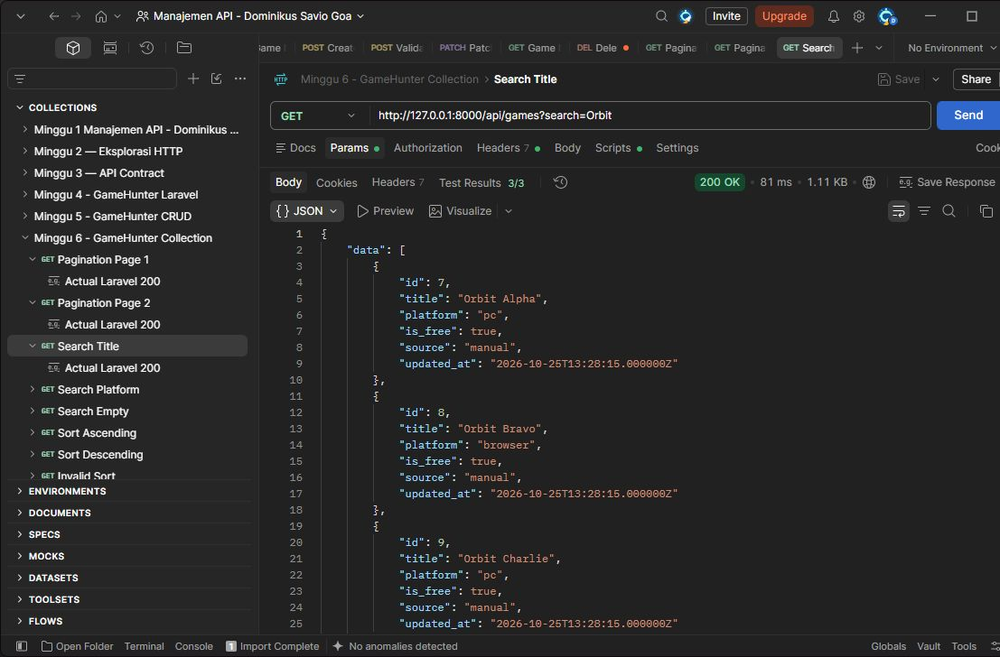
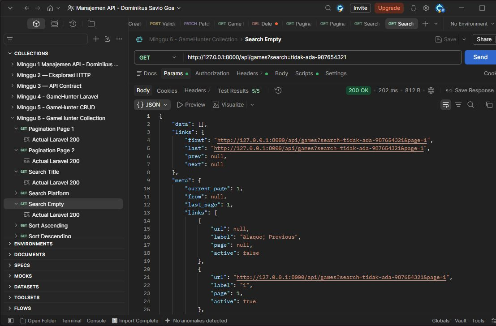
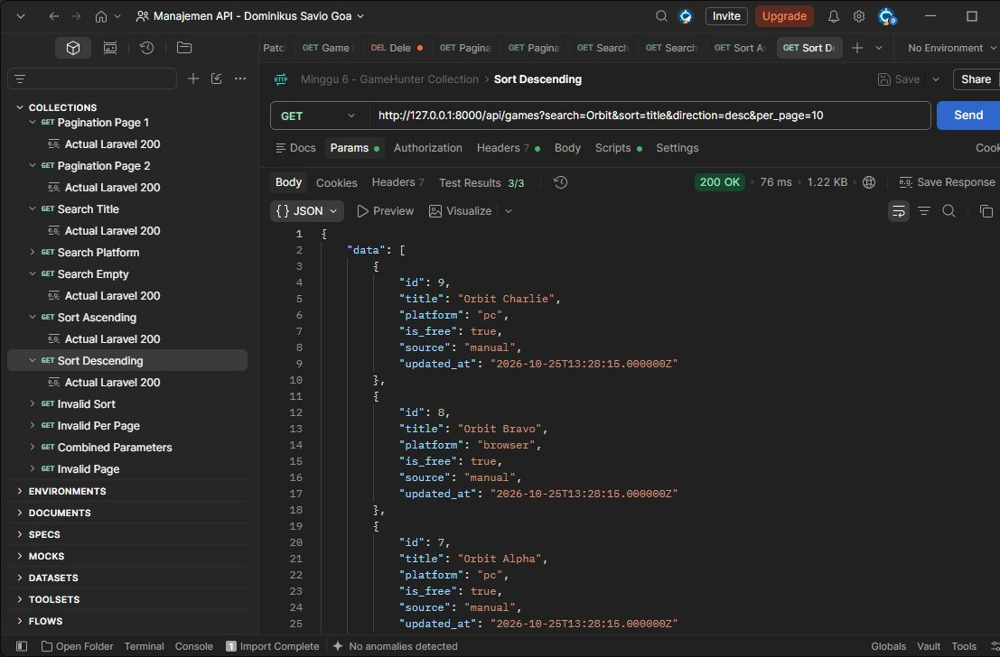
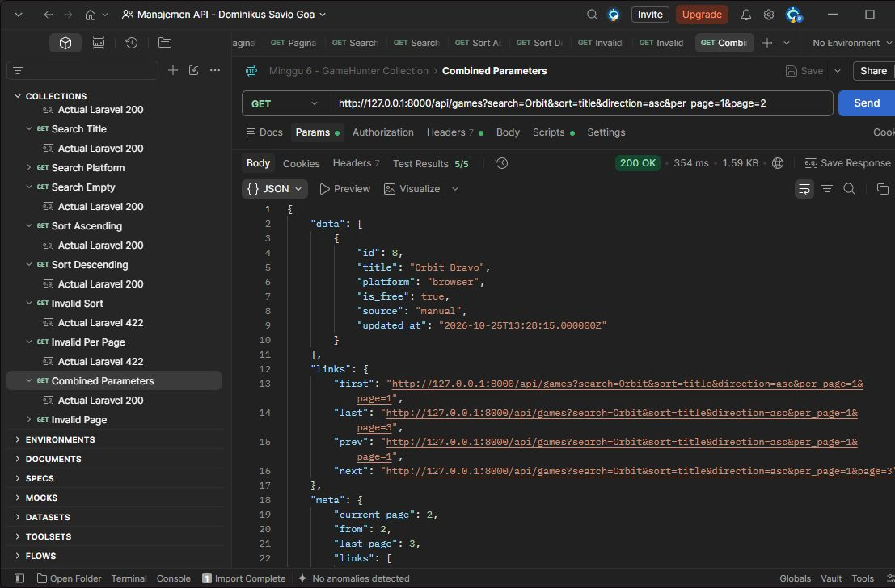

# Tugas 6 — Endpoint Collection yang Dapat Dicari

## 1. Tujuan

Saya menerapkan pagination, pencarian, sorting terkontrol, dan validasi query pada resource utama GameHunter, yaitu `Game`. Implementasi melanjutkan Praktikum 6.

## 2. Endpoint dan query contract

`GET http://127.0.0.1:8000/api/games` dengan header `Accept: application/json` dan No Auth.

| Parameter | Contract |
| --- | --- |
| page | Integer minimal 1; default 1 |
| per_page | Integer 1–50; default 5 |
| search | String maksimal 100 karakter; opsional, boleh kosong |
| sort | `id`, `title`, `platform`, `created_at`; default `id` |
| direction | `asc` atau `desc`; default `asc` |
| platform | Filter tepat `pc` atau `browser`; opsional |

Respons berhasil memakai `GameResource` dengan `data`, `links`, dan `meta`. Setiap game berisi `id`, `title`, `platform`, `is_free`, `source`, dan `updated_at`.

## 3. Field search dan sort allowlist

Search mencocokkan sebagian **title atau platform**. Sorting dibatasi pada empat field di atas agar input tidak dapat memilih kolom sembarang. Jika nilai sorting sama, ID menjadi urutan tambahan agar perpindahan halaman stabil.

## 4. Validation rules

Query divalidasi sebelum database dibaca. `page=0`, `per_page=100`, `sort=password`, arah selain `asc|desc`, nilai array, dan parameter tidak dikenal menghasilkan JSON `422`. Search kosong tetap diterima.

## 5. Bukti pagination dan metadata

Pengujian ulang pada **29 Oktober 2026** menggunakan lima game. Default menghasilkan halaman 1, `per_page=5`, dan total 5. Custom `per_page=2&page=1` menghasilkan ID 1 dan 2; halaman 2 menghasilkan ID 7 dan 8.

`meta` memuat `current_page`, `last_page`, `per_page`, dan `total`. `links` menyediakan navigasi dan tetap membawa query melalui `withQueryString()`.





Screenshot berasal dari pengujian Praktikum 6 pada 25 Oktober. URL, status, dan body lengkap dari pengujian ulang tersimpan sebagai **Examples** pada [koleksi Postman](postman/week-06-pagination-filtering-sorting.postman_collection.json).

## 6. Bukti search pada dua field

| Request | Status dan hasil aktual |
| --- | --- |
| `?search=Orbit` | 200; Orbit Alpha, Orbit Bravo, Orbit Charlie |
| `?search=browser` | 200; Game Contoh Browser dan Orbit Bravo |
| `?search=tidak-ada-987654321` | 200; `data: []`, total 0 |

Orbit Bravo tidak memiliki kata “browser” pada judulnya. Hasil tersebut membuktikan pencarian juga membaca field `platform`.





## 7. Bukti sorting dan kombinasi

`?search=Orbit&sort=title&direction=asc&per_page=10` menghasilkan Alpha → Bravo → Charlie. Dengan `direction=desc`, hasilnya Charlie → Bravo → Alpha. Keduanya `200`.




Kombinasi `?search=Orbit&sort=title&direction=asc&per_page=1&page=2` menghasilkan Orbit Bravo, total 3, halaman terakhir 3. Link berikutnya tetap memuat search, sort, direction, dan per_page.



## 8. Bukti error 422

`GET /api/games?sort=password` menghasilkan `422` dengan body aktual:

```json
{
  "message": "The selected sort is invalid.",
  "errors": {
    "sort": ["The selected sort is invalid."]
  }
}
```

`per_page=100` menghasilkan `errors.per_page`; `page=0` menghasilkan `errors.page`.


## 9. Perbandingan actual response dan API contract

| Contract | Actual response |
| --- | --- |
| Collection berhasil 200 | Seluruh request valid menghasilkan 200 |
| Pagination default 5, maksimal 50 | Default 5; per_page 100 ditolak 422 |
| Search title atau platform | Kedua field menghasilkan game yang sesuai |
| Sort allowlist dan asc/desc | Urutan sesuai; sort sembarang ditolak |
| Data, links, meta | Ketiganya tersedia; total dan halaman sesuai |
| Query tetap pada link | Link kombinasi mempertahankan parameter |

**72 test Game dengan 243 assertion lulus.** Newman menjalankan **12 request dan 62 assertion**, tanpa kegagalan. Koleksi mencakup seluruh skenario wajib, termasuk default pagination dan search dua field.

Untuk mengulang: jalankan `php artisan serve` pada project Laravel, impor koleksi di atas, lalu pilih **Run collection**. `base_url` sudah tersedia. Gunakan masing-masing satu game: Orbit Alpha (`pc`), Orbit Bravo (`browser`), Orbit Charlie (`pc`). Jika belum ada, tambahkan melalui POST `/api/games` dengan body `{"title":"Orbit Alpha","platform":"pc","is_free":true}`, lalu sesuaikan judul/platform untuk dua game lainnya.

Tes project: `php artisan test --compact --filter=Game`. Alternatif menjalankan koleksi:

```bash
npx newman run docs/postman/week-06-pagination-filtering-sorting.postman_collection.json
```

Contoh ID dan total mengikuti data saat pengujian. Repository pengumpulan berisi laporan, koleksi, dan gambar; server dijalankan dari project Laravel lokal.

## 10. Kesimpulan

Collection GameHunter sudah dapat dicari, diurutkan, dan dipaginasi. Validasi serta bentuk respons sesuai contract. Relasi database tidak diperlukan untuk scope tugas ini.

## 11. Referensi

- Materi 6 dan Praktikum 6 dari dosen.
- [Laravel 13 — Pagination](https://laravel.com/framework/docs/13.x/pagination)
- [Laravel 13 — API Resources](https://laravel.com/framework/docs/13.x/eloquent-resources)
- [Laravel 13 — Validation](https://laravel.com/framework/docs/13.x/validation)
- [Postman — Import data](https://learning.postman.com/docs/getting-started/importing-and-exporting/importing-data)

## 12. Deklarasi penggunaan AI

AI membantu saya dalam praktikum dan langkah pengerjaan saat ada kendala.
